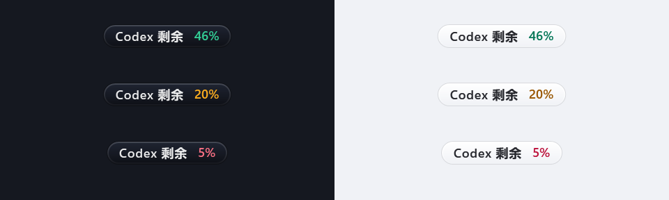

# Codex quota on Windows orbs

Enable **Settings → Sources → Codex quota on orbs** to add a quota capsule to visible orbs that include Codex.
The option is off by default and requires network access for account details. It uses the Codex account already
signed in on this computer; there is no additional Agent Speed account or sign-in flow. macOS is unchanged.



## Display

- The capsule reuses the native name plate's material, font, rounded shape, opacity, high-contrast treatment,
  reduced-motion behavior and batched orb movement. It appears below the orb and moves above it at the bottom edge.
- When more than one quota window is returned, the capsule shows the smallest remaining percentage. Percentages
  are `floor(clamp(100 - usedPercent, 0, 100))`, independently of the token totals measured by Agent Speed.
- At least 30% remaining is green, 10–29% is amber, and below 10% is red. Unavailable or stale readings are neutral;
  an elapsed reset timestamp never invents a full quota. Color is accompanied by a numeric value or status.
- The tooltip shows all supplied quota windows, reset and update times, available reset-card count, and known
  expiry times. Expiry includes seconds and the local UTC offset. All times use the computer's local time zone.
  Labels follow the app's English, Simplified Chinese, Traditional Chinese or Japanese setting.
- Missing card counts and missing expiry details remain explicitly unavailable; a partial detail list does not
  replace the server's authoritative available count. Known expired cards are removed exactly once.

## Updates and privacy

Quota follows `event_msg.payload.type=token_count` events containing `rate_limits` in existing Codex transcripts.
There is no additional file watcher and no fixed network polling. A `token_usage_record` without quota fields
does not change the quota.

On launch/enable, opening the tooltip, observing quota recovery, or reaching a known card expiry, the app reads
`account/rateLimits/read` through its own local Codex app-server helper. An in-flight read can queue one follow-up.
The single expiry timer first removes expired known cards locally, including offline, and then rechecks details.
Failed metadata reads can retry with later response activity, no more than once a minute.

The helper delegates authentication and account-service access to installed Codex. Agent Speed does not read or
copy auth files, send prompts, use reset cards, or store account quota in its history, reports or settings. Results
stay in memory. Disabling the option, network access or all eligible orbs stops the helper and expiry timer. The
helper is closed after each request; the app does not stop other Codex sessions. See [NETWORK 7](../spec/NETWORK.md#7-codex-account-quota-windows-opt-in).

Card use on another computer is not pushed to an idle Agent Speed instance. Opening the tooltip rechecks the
signed-in account. If Codex or its account API does not provide card metadata, response-based quota can still work
and missing card details remain unavailable. Codex CLI discovery supports a running desktop CLI, the local desktop
installation and `codex.exe` on PATH; `CODEX_EXE` can specify an absolute executable path. A local sign-in is required
for account details. These reads use the local Codex account, including when monitoring a custom transcript folder.

## Verification

The quota tests use synthetic transcript/RPC fixtures and injected clocks/readers: window selection, malformed or
missing data, legacy responses, parser/monitor updates, warning boundaries, all four languages, time-zone conversion,
opt-in settings, card consumption/recovery, offline expiry, and no account reads while disabled or idle. Native WPF
tests render the capsules in both themes and check that attached windows move with the orb. No reset card is consumed.

Run from the repository root with .NET 10 on Windows:

```powershell
dotnet test windows/tests/AgentSpeed.Core.Tests -c Release
dotnet test windows/tests/AgentSpeed.Presentation.Tests -c Release
dotnet test windows/tests/AgentSpeed.Windows.Tests -c Release
```

This change contains source, documentation and tests. It preserves the standard installer and update mechanism.
